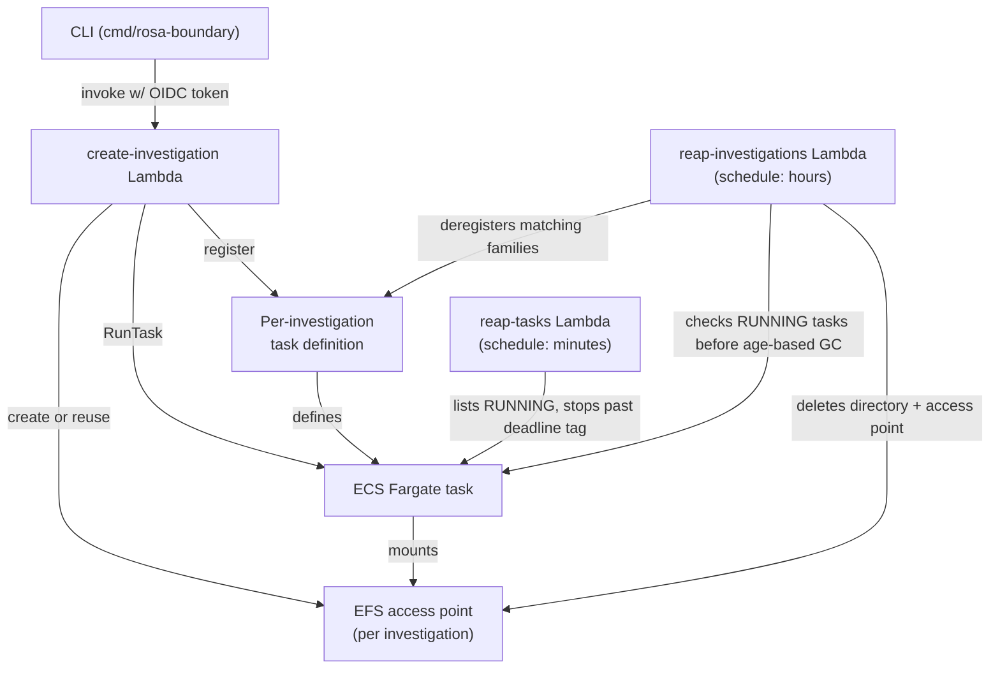

# System overview and boundaries

ROSA Boundary is an operator CLI plus a regional AWS runtime for ephemeral SRE investigations. The system separates operator authentication and orchestration from privileged resource creation and task execution: the Go CLI obtains OIDC-backed AWS credentials, the create-investigation Lambda validates the user's token and provisions the investigation, and ECS Fargate runs the SRE tool container. Two independent scheduled Lambdas reclaim resources on different horizons — one enforces per-task deadlines, the other garbage-collects whole stale investigations. Terraform owns the regional AWS resources; the repository's Kustomize manifests separately define the Keycloak deployment components.

## Responsibility boundaries

- **CLI (`cmd/rosa-boundary`, `internal/`)** — exposes login/configuration and investigation/task commands. Shared command setup resolves configuration and performs OIDC-to-STS authentication. `start-task` invokes Lambda directly through the AWS SDK, assumes the shared SRE role for ECS operations, optionally waits for task readiness, and can configure credentials or connect.
- **Create-investigation Lambda (`lambda/create-investigation/`)** — is the authorization and provisioning boundary. It validates the OIDC token and group claims, establishes the ABAC identity, creates or reuses the investigation's EFS access point, and when requested registers a task definition and launches a Fargate task.
- **ECS task (`Containerfile`, `entrypoint.sh`)** — is the ephemeral operator environment. ECS Exec sessions enter as `sre`; the root entrypoint performs controlled setup, verifies task-scoped credential overlays, then launches the requested workload as `sre`. On shutdown it attempts a bounded S3 sync of the persistent home while excluding credential state.
- **Terraform (`deploy/account/`, `deploy/regional/`)** — the account root owns shared IAM identities, OIDC providers, and common managed-policy attachments, including the investigation reaper's VPC execution attachment. Regional roots look up those identities and own regional inline grants alongside ECS, EFS, S3, KMS/logging, and Lambda resources. Each region uses a distinct inline-policy name suffix except the single designated legacy region; these grants accumulate on shared roles rather than creating region-isolated identities. The regional task definition mounts a shared EFS home and empty per-task overlays at OCM and kubeconfig paths; the investigation Lambda replaces the home volume with an investigation-specific access point at launch.
- **Reap-tasks Lambda (`lambda/reap-tasks/`)** — runs on a short schedule (every `var.reaper_schedule_minutes` minutes) and enforces the *per-task* deadline: it lists RUNNING tasks, stops those past their `deadline` tag, and defers stopping a task with an active ECS Exec/SSM session.
- **Reap-investigations Lambda (`lambda/reap-investigations/`)** — independently garbage-collects whole stale investigations: EFS directory contents, access points, and matching per-investigation task definitions. It runs every `var.investigation_reaper_schedule_hours` hours (default 8). Eligibility requires no RUNNING task and an access-point creation age greater than `var.investigation_grace_period_hours` (Terraform default 168h; the handler's fallback without that environment setting is 72h). Missing `CreatedAt` is treated as legacy state and becomes eligible as soon as no task is running. This is an age threshold, not an idle-duration timer, and is separate from reap-tasks' per-task deadline.
- **Tests** — Go and Lambda unit tests isolate logic with fakes/mocks; bats tests exercise shell boundaries; Terraform tests validate input constraints; LocalStack integration tests exercise AWS resource/API interactions using fixture-created resources.

## Main request flow

For a new task, the CLI authenticates as the operator and assumes the Lambda invoker role. It invokes the create-investigation Lambda with cluster and investigation identifiers. The Lambda checks the caller's token and required group membership and looks for an EFS access point rooted at `/<cluster-id>/<investigation-id>`. If a task is already running for the same investigation, the Lambda performs a handover before creating a new access point or launching a replacement: it describes existing tasks and checks SSM/ECS Exec sessions for containers with a `runtimeId`. Active sessions, empty task details, and ECS/SSM API errors block handover; containers without a `runtimeId` skip the session lookup, so the guard is not universally fail-closed. If preflight passes, it stops the existing tasks and waits for `STOPPED`, then reuses or creates the access point. For a task launch it builds a per-investigation task definition from the configured base definition — replacing the EFS home volume with the investigation's access point, enforcing task-scoped (non-EFS) overlay volumes for the OCM config and kubeconfig credential paths, baking investigation-specific environment variables into the SRE container, and injecting a Secrets Manager kubeconfig reference into the `kube-proxy` sidecar's `secrets` — then calls ECS `RunTask` with ECS Exec enabled and tags needed for ABAC, audit, and task-timeout enforcement. The CLI next assumes the shared SRE role, waits for `RUNNING` unless `--no-wait` was selected, and emits connection details (or joins when requested).

The CLI distinguishes the ROSA cluster identifier being investigated from the ECS cluster that hosts the task. Lambda receives the former as investigation context; ECS API calls use the configured ECS cluster name.

*How the CLI, create-investigation Lambda, ECS, EFS, and the two independent reaper Lambdas relate: reap-tasks acts on individual running tasks, reap-investigations acts on whole stale investigations across EFS and task definitions.*

## State and containment

Investigation work files persist in an EFS access point scoped to the ROSA cluster and investigation identifiers. OCM configuration and kubeconfig are mounted over that home from task-scoped empty volumes so they do not persist with EFS. The container's exit sync is best-effort and time-bounded; it excludes those credential-bearing paths and does not follow symlinks.

Two scheduled Lambdas reclaim resources independently, at different scopes and on different schedules:

- **reap-tasks** checks task deadlines from ECS tags on a short interval and stops expired tasks, but defers stopping a task with an active Exec session — the timeout printed by the container is informational, not the enforcement mechanism.
- **reap-investigations** runs on a much longer interval and operates on whole investigations rather than individual tasks. For each EFS access point tagged `ManagedBy = rosa-boundary-lambda`, it checks whether the investigation currently has any RUNNING task; an investigation with a matching running task is not stale regardless of age. With no running task, `now - CreatedAt` must be strictly greater than `GRACE_PERIOD_HOURS`, or `CreatedAt` must be absent (legacy cleanup). Restarting or stopping a task does not reset the access point's creation timestamp or start a new grace period. Reaping re-verifies task absence immediately before deletion using the investigation's deterministic `startedBy`, then (1) backs up any existing EFS directory to S3 (refusing to delete that directory if backup fails or `S3_AUDIT_BUCKET` is unset), (2) deletes the directory tree, (3) deletes the access point, and (4) deregisters task definitions whose family matches `{TASK_DEFINITION_FAMILY}-{cluster_id}-{investigation_id}-<timestamp>`. The access point is deleted only if directory deletion succeeded or the directory was already absent; task-definition deregistration is attempted regardless of the earlier steps' outcome. The reaper mounts EFS itself via a dedicated root-level access point and validates that resolved investigation paths stay within that mount before deletion.

Stopping a task through reap-tasks does not itself remove the investigation's EFS data or access point. Whole-investigation cleanup is reap-investigations' job: an old-enough investigation, or a legacy one missing `CreatedAt`, can qualify on the next scheduled check after its last running task stops, without an additional idle-period wait.

## Verification boundaries

LocalStack integration tests create representative IAM, ECS, and EFS resources and assert cross-service relationships such as task tags, task-definition EFS access-point wiring, deadline processing, and cleanup. They are not a substitute for the Go/Lambda unit tests or shell tests, which cover logic and failure paths unavailable from an AWS API integration test alone. The LocalStack suite may not execute task containers under the local executor; this is explicit in the slow end-to-end test's skip condition.

## Evidence-backed claims

- The CLI uses a centralized OIDC/STS pre-run hook and selects the Lambda invoker role for create/start commands, with a separate SRE role for operational commands. [CLI root](repo://internal/cmd/root.go#L154-L207) · [task-start orchestration](repo://internal/cmd/start_task.go#L90-L207)
- The Lambda validates the user, creates/reuses an investigation EFS access point, performs a session-checked handover of any existing running task, registers a per-investigation task definition with task-scoped credential overlays, and launches a Fargate task with ECS Exec and identifying/deadline tags. [authorization and dispatch](repo://lambda/create-investigation/handler.py#L175-L281) · [handover preflight and stop](repo://lambda/create-investigation/handler.py#L682-L774) · [task-definition registration](repo://lambda/create-investigation/handler.py#L469-L638) · [task launch and tagging](repo://lambda/create-investigation/handler.py#L886-L999)
- ECS task infrastructure mounts persistent EFS home plus task-scoped OCM and kubeconfig overlays; entrypoint rejects missing or EFS-backed overlays and uses a protected S3 sync on exit. [task mounts](repo://deploy/regional/ecs.tf#L62-L159) · [mount verification and sync](repo://entrypoint.sh#L3-L80)
- The reap-tasks Lambda lists RUNNING tasks and stops expired tasks without an active Exec session; missing or malformed deadlines are skipped. [reaper implementation](repo://lambda/reap-tasks/handler.py#L48-L175)
- The independently scheduled reap-investigations Lambda garbage-collects whole investigations rather than enforcing task deadlines. A matching RUNNING task blocks eligibility; otherwise creation age must exceed the grace period, or `CreatedAt` must be missing. Task absence is rechecked immediately before cleanup. [schedule](repo://deploy/regional/lambda-reap-investigations.tf#L216-L239) · [eligibility](repo://lambda/reap-investigations/handler.py#L252-L321) · [final task check](repo://lambda/reap-investigations/handler.py#L204-L223) · [Terraform defaults](repo://deploy/regional/variables.tf#L402-L422)
- Handover blocks on active sessions, empty task details, and ECS/SSM errors, but skips the SSM lookup for containers without a `runtimeId`; it stops tasks and waits for termination only after preflight. [handover guard and ordering](repo://lambda/create-investigation/handler.py#L682-L774)
- Account Terraform owns the shared investigation-reaper role and its basic/VPC execution managed-policy attachments; regional roots look up shared roles and use region-suffixed inline policies outside the one legacy region. [shared reaper identity and attachments](repo://deploy/account/modules/shared-iam/lambda-reap-investigations.tf#L1-L19) · [regional lookup and suffix contract](repo://deploy/regional/account-iam.tf#L1-L35) · [account handoff outputs](repo://deploy/account/outputs.tf#L1-L12)
- LocalStack integration tests verify relationships between provisioned task tags, shared-role ABAC, access points, and task-definition mounts; execution of actual task containers is conditionally skipped for the local executor. [full workflow assertions](repo://tests/localstack/integration/test_full_workflow.py#L21-L137) · [container-execution condition](repo://tests/localstack/integration/test_full_workflow.py#L214-L220)

## Related pages

- [Investigation lifecycle](../workflows/investigation-lifecycle.md) — handover, close, timeout, and garbage-collection details.
- [Regional infrastructure](../infrastructure/regional-runtime.md) and [HCP workspaces](../infrastructure/hcp-terraform-workspaces.md) — resource ownership and staging's regional states.
- [Identity and access](identity-and-access.md) and [auditing](../operations/audit-and-logging.md) — authorization and operational evidence.
