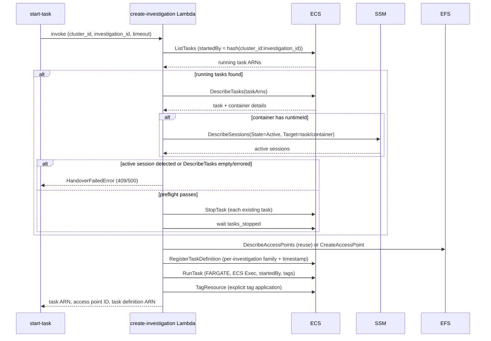

# Investigation lifecycle

An investigation is durable EFS-backed workspace state identified by a ROSA cluster ID and investigation ID. An ECS task is a replaceable execution session using that workspace. Creating a workspace, launching/replacing a task, stopping a task, closing the investigation, and garbage-collecting a stale investigation are separate lifecycle operations; stopping a task alone does not remove the EFS access point or workspace data.

## Create workspace or start a task

`create-investigation` invokes the Lambda with `skip_task=true`. The Lambda validates the operator and request, finds an available access point with matching `ClusterID` and `InvestigationID` tags, and verifies that its root path is exactly `/<cluster-id>/<investigation-id>`. If none is found, it creates one with `sre` UID/GID ownership and investigation/owner tags. The skip-task path returns the access point without scanning for or launching ECS tasks, allowing a workspace to be prepared with no running task.

`start-task` invokes the same Lambda without `skip_task`. It may generate a three-word investigation ID, sends the target cluster, OC version, and task timeout, then assumes the shared SRE role and waits for the task to reach `RUNNING` unless `--no-wait` is set. The ROSA cluster ID scopes investigation state; the separately configured ECS cluster is where the task is launched and managed.

## Replace task safely

Before starting a replacement task, the Lambda finds running tasks by a deterministic `startedBy` value derived from both cluster ID and investigation ID. Before stopping any existing task, it calls `DescribeTasks`; an empty result or an ECS/SSM API error blocks handover. For returned tasks, it queries SSM for active sessions only when a container has a `runtimeId`. A detected active session blocks handover, and the full preflight runs before any task is stopped, so a detected session prevents partial stops of other tasks in the same handover. **Current behavior caveat:** if task details contain no containers, or a container has no `runtimeId`, that container is skipped without an SSM lookup and the handover can proceed to stop the task. The unit tests cover empty task details, active sessions, and SSM errors, but do not cover the missing-`runtimeId` case. If preflight passes, the Lambda stops existing tasks and waits for termination before proceeding; a stop or wait failure prevents the new task launch.

The Lambda then reuses the investigation access point or creates one. It registers a uniquely named task definition based on the base family plus cluster ID, investigation ID, and timestamp. This copy points `/home/sre` at the investigation access point, overlays task-scoped OCM/kubeconfig volumes, preserves unrelated mounts, and injects investigation-specific environment values. ECS `RunTask` starts Fargate with ECS Exec enabled, private-IP networking, a deterministic `startedBy`, and task tags for owner/ABAC, investigation, access point, creation time, and timeout. A deadline tag is added only when timeout is greater than zero. Tags are also applied explicitly after launch for timely IAM evaluation.

If task-definition registration or task launch fails, the Lambda cleans up a newly created access point and deregisters the new task definition where possible. If applying task tags fails after launch, it also stops the task. A reused access point is retained during rollback because it may hold existing investigation data.

*Task handover: discover running tasks by `startedBy`, preflight for active sessions, stop and wait, then reuse/create the EFS access point and relaunch.*

## Connect and inspect

`join-task` describes the task, waits for `RUNNING` unless configured not to, then waits up to 30 seconds for the chosen container's ECS Exec agent before requesting a session and handing control to `session-manager-plugin`. `start-task --connect` uses the same connection path after optional credential setup succeeds. `list-tasks` queries ECS and presents task tags; `list-investigations` discovers workspaces from EFS access point tags, so a workspace remains listed even when no task is running.

## Stop, timeout, and close

`stop-task` requests ECS termination and can optionally wait for `STOPPED`. Container shutdown is handled by the entrypoint and attempts the S3 audit sync. The reaper Lambda (`reap-tasks`) provides independent timeout enforcement: EventBridge invokes it periodically, it paginates RUNNING tasks, describes them in batches of up to 100, and stops tasks whose ISO-8601 `deadline` has passed **unless an active ECS Exec/SSM session is detected**. Tasks without deadlines, with future deadlines, with malformed deadline values, or with active sessions are skipped; per-task stop/describe failures are counted without abandoning the rest of the batch.

`close-investigation` finds the access point by investigation tag and optional cluster tag; omitting cluster ID is rejected when that investigation ID matches multiple clusters. It refuses to continue if tasks are running unless `--force` is supplied. With force, it stops and waits for matching running tasks, then deregisters active task definitions with a family prefix scoped to the ECS cluster, cluster ID, and investigation ID. It prompts before deleting the access point unless `--yes` is set. Deleting the access point does not delete its underlying EFS directory contents.

These three cleanup paths are independent and address different scopes: `close-investigation` is operator-initiated and acts immediately on a single named investigation; `reap-tasks` enforces a per-task deadline regardless of the investigation's age; and the investigation-level `reap-investigations` garbage collector (below) periodically reclaims whole investigations — directory, access point, and task definitions — purely based on investigation age and the absence of a running task. None of the three triggers or disables the others.

## Investigation-level garbage collection (reap-investigations)

`reap-investigations` is the investigation-level complement to the task-level `reap-tasks` reaper: where `reap-tasks` enforces a per-task deadline, `reap-investigations` reclaims an entire investigation's workspace once it has been idle, with no running task, for longer than a grace period. It runs on its own EventBridge schedule (`investigation_reaper_schedule_hours`, Terraform default every 8 hours) and shares no state with `reap-tasks` or `close-investigation`.

Each run lists every EFS access point on the shared filesystem via `describe_access_points` (no server-side tag filter — filtering happens in the handler), then for each access point:

1. Rejects access points missing the `ManagedBy=rosa-boundary-lambda` tag or missing `ClusterID`/`InvestigationID` tags, as defense-in-depth alongside the IAM policy that already restricts `DeleteAccessPoint` to that tag value.
2. Validates `ClusterID` and `InvestigationID` against an allow-list pattern and rejects `.`, `..`, or embedded `/` — the same validation style used by `create-investigation` — before either is used to build a filesystem path.
3. Verifies the access point's `RootDirectory.Path` equals the expected `/<cluster-id>/<investigation-id>`, rejecting mismatches as errors rather than silently skipping.
4. Determines staleness: an investigation with at least one RUNNING task — matched via the same deterministic `startedBy = sha256(cluster_id:investigation_id)[:36]` scheme used by `create-investigation` — is never stale regardless of age. With no running task, staleness requires that `GRACE_PERIOD_HOURS` (handler default `72` when the environment variable is unset; the Terraform module instead defaults `investigation_grace_period_hours` to `168`, i.e. 7 days) has elapsed since the access point's `CreatedAt` tag, which records creation time rather than being refreshed by later task activity. If `CreatedAt` is missing and the grace period is non-zero, the investigation is treated as not-yet-stale rather than reaped blindly.
5. Re-lists RUNNING tasks for the specific investigation immediately before reaping, to avoid a race where a task started between the initial bulk scan and this investigation's turn.

Reaping an investigation performs three ordered steps, continuing to the next step even if an earlier one fails so that partial cleanup still makes progress:

- **Delete the EFS directory contents.** The handler mounts a dedicated root-access-point (`aws_efs_access_point.reaper`, UID/GID 0) at `/mnt/efs`, builds `/mnt/efs/<cluster_id>/<investigation_id>`, and validates that the resolved real path stays inside the mount root before calling `shutil.rmtree` — guarding against path traversal even though the identifiers were already validated upstream. If `S3_AUDIT_BUCKET` is configured, it first uploads the directory tree to `s3://<bucket>/<cluster_id>/<investigation_id>/reaper-final-backup/` (excluding `.config/ocm/*` and `.kube/*`, matching the entrypoint's own exclusions, and skipping symlinks); a failed or deadline-exceeded backup blocks directory deletion so data is never silently lost.
- **Delete the EFS access point**, only after directory deletion succeeds — directory deletion must happen first because the access point's tags are the only record of where the directory lives, so deleting the access point first would make an undeleted directory unreclaimable.
- **Deregister task definitions** whose family matches `{TASK_DEFINITION_FAMILY}-{cluster_id}-{investigation_id}-<timestamp>`, the same naming scheme `create-investigation` uses when it registers a per-investigation task definition. This step runs even if the earlier directory or access-point steps failed.

The handler tracks the Lambda's remaining execution time and stops processing further access points (reserving roughly 30 seconds for cleanup) once the deadline is close, so a single invocation degrades to partial progress instead of timing out mid-deletion.

## Failure boundaries and tests

Lambda unit tests cover skip-task behavior, access-point reuse, handover guards, task definition shaping, and rollback differences for newly created versus reused access points. For the handover guard, they cover empty task details and active-session/SSM-error failures, but not a task whose container lacks `runtimeId`. The `reap-investigations` unit tests cover the happy-path reap, running-task and grace-period skips, tag/path validation failures (including simulated path-traversal values in `ClusterID`), partial-failure continuation across the directory/access-point/task-definition steps, S3 backup success/failure/exclusion behavior, and pagination. LocalStack integration tests check EFS/ECS relationships, close behavior and ambiguity, task-definition family scoping, and the end-to-end deadline-tag/reaper path. Slow cases that require a task to reach `RUNNING` are skipped with LocalStack's local ECS executor.

## Evidence-backed claims

- Workspace-only creation uses `skip_task` to make/reuse an EFS access point without launching a task; access-point reuse requires available state, matching cluster/investigation tags, and the expected root path. [skip-task branching](repo://lambda/create-investigation/handler.py#L676-L820) · [path/tag verification](repo://lambda/create-investigation/handler.py#L432-L466) · [unit tests](repo://lambda/create-investigation/test_handler.py#L704-L855)
- Task replacement uses deterministic `startedBy` discovery and checks SSM sessions only for containers with a `runtimeId`; empty task details, detected active sessions, and ECS/SSM API errors fail closed, but missing `runtimeId` skips that session lookup and can allow stopping. The handover tests cover the fail-closed cases but not missing `runtimeId`. [discovery](repo://lambda/create-investigation/handler.py#L31-L45) · [conditional session lookup and stop sequence](repo://lambda/create-investigation/handler.py#L691-L774) · [handover tests](repo://lambda/create-investigation/test_handler.py#L1242-L1517)
- The Lambda derives a per-investigation task definition with a unique family, investigation-specific EFS and task-scoped credential mounts, and launches Fargate with ECS Exec and investigation/deadline tags. [task definition registration](repo://lambda/create-investigation/handler.py#L469-L638) · [ECS launch and tags](repo://lambda/create-investigation/handler.py#L822-L950)
- Rollback removes newly created access points, and tag-application failure also stops an already launched task; reused access points are preserved. [registration-failure cleanup](repo://lambda/create-investigation/handler.py#L843-L862) · [tag-failure cleanup](repo://lambda/create-investigation/handler.py#L951-L993) · [reused access-point rollback test](repo://lambda/create-investigation/test_handler.py#L2091-L2157)
- The reaper processes RUNNING tasks, stopping expired deadlines only when no active Exec session is detected, and skipping absent, future, or malformed values; the integration suite chains task tags into reaper enforcement. [reaper behavior](repo://lambda/reap-tasks/handler.py#L48-L175) · [schedule](repo://deploy/regional/lambda-reap-tasks.tf#L42-L66) · [deadline lifecycle integration](repo://tests/localstack/integration/test_full_workflow.py#L214-L287)
- Close requires explicit force to stop running tasks, scopes task-definition cleanup by family prefix, confirms before access-point deletion by default, and leaves EFS data in place. [close workflow](repo://internal/cmd/close_investigation.go#L96-L186) · [tag-based AP lookup](repo://internal/aws/efs.go#L42-L100) · [family scoping and cleanup test](repo://tests/localstack/integration/test_close_investigation.py#L67-L143)
- Join waits for task and ECS Exec agent readiness before opening the SSM session; LocalStack tests cover task stop and cross-component lifecycle behavior, with actual task launch tests requiring a non-local executor. [join sequence](repo://internal/cmd/join_task.go#L57-L101) · [LocalStack executor gate](repo://tests/localstack/integration/test_task_timeout.py#L16-L78)
- `reap-investigations` runs on its own EventBridge schedule, lists all EFS access points and filters to tagged, path-verified investigations, and treats an investigation as stale only when it has no RUNNING task (matched via the same deterministic `startedBy` scheme as `create-investigation`) and `GRACE_PERIOD_HOURS` has elapsed since the access point's recorded creation time. [schedule](repo://deploy/regional/lambda-reap-investigations.tf#L224-L231) · [listing and tag/path validation](repo://lambda/reap-investigations/handler.py#L134-L180) · [identifier validation](repo://lambda/reap-investigations/handler.py#L71-L82) · [staleness logic](repo://lambda/reap-investigations/handler.py#L252-L319) · [shared startedBy scheme](repo://lambda/reap-investigations/handler.py#L54-L68)
- Reaping a stale investigation deletes the EFS directory (after a required S3 backup attempt) before deleting the access point, then deregisters task definitions sharing the investigation's family prefix, continuing to later steps even if an earlier one fails; filesystem paths are validated against traversal before deletion. [ordered reap steps](repo://lambda/reap-investigations/handler.py#L462-L517) · [path validation and deletion](repo://lambda/reap-investigations/handler.py#L660-L710) · [family-prefix deregistration](repo://lambda/reap-investigations/handler.py#L737-L802) · [happy-path test](repo://lambda/reap-investigations/test_handler.py#L156-L208) · [path-traversal test](repo://lambda/reap-investigations/test_handler.py#L840-L863)
- `reap-investigations` is independent of and complements `close-investigation` (operator-initiated, immediate, single investigation) and the `reap-tasks` timeout reaper (task-level deadline enforcement): the three cleanup paths use different triggers and scopes and none depends on or disables another. [reaper purpose](repo://lambda/reap-investigations/handler.py#L1-L15) · [reap-tasks purpose](repo://lambda/reap-tasks/handler.py#L1-L6) · [close workflow](repo://internal/cmd/close_investigation.go#L96-L186)
