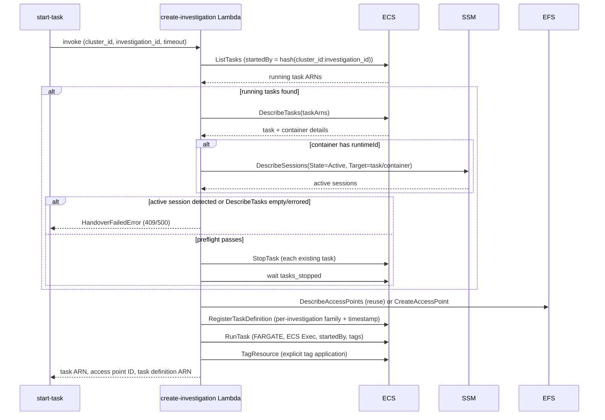

# Investigation lifecycle

An investigation is durable EFS-backed workspace state identified by a ROSA cluster ID and investigation ID. An ECS task is a replaceable execution session using that workspace. Creating a workspace, launching/replacing a task, stopping a task, closing the investigation, and garbage-collecting a stale investigation are separate lifecycle operations; stopping a task alone does not remove the EFS access point or workspace data.

## Create workspace or start a task

`create-investigation` invokes the Lambda with `skip_task=true`. The Lambda validates the operator and request, finds an available access point with matching `ClusterID` and `InvestigationID` tags, and verifies that its root path is exactly `/<cluster-id>/<investigation-id>`. If none is found, it creates one with `sre` UID/GID ownership and investigation/owner tags. The skip-task path returns the access point without scanning for or launching ECS tasks, allowing a workspace to be prepared with no running task.

`start-task` invokes the same Lambda without `skip_task`. It may generate a three-word investigation ID, sends the target cluster, OC version, and task timeout, then assumes the shared SRE role and waits for the task to reach `RUNNING` unless `--no-wait` is set. The ROSA cluster ID scopes investigation state; the separately configured ECS cluster is where the task is launched and managed.

## Replace task safely

Before starting a replacement task, the Lambda finds running tasks by a deterministic `startedBy` value derived from both cluster ID and investigation ID. Before stopping any existing task, it calls `DescribeTasks`; an empty result or an ECS/SSM API error blocks handover. For returned tasks, it queries SSM for active sessions only when a container has a `runtimeId`. A detected active session blocks handover, and the full preflight runs before any task is stopped, so a detected session prevents partial stops of other tasks in the same handover. **Current behavior caveat:** if task details contain no containers, or a container has no `runtimeId`, that container is skipped without an SSM lookup and the handover can proceed to stop the task. The unit tests cover empty task details, active sessions, and SSM errors, but do not cover the missing-`runtimeId` case. If preflight passes, the Lambda stops existing tasks and waits for termination before proceeding; a stop or wait failure prevents the new task launch.

The Lambda then reuses the investigation access point or creates one. It registers a uniquely named task definition based on the base family plus cluster ID, investigation ID, and timestamp. This copy points `/home/sre` at the investigation access point, overlays task-scoped OCM/kubeconfig volumes, preserves unrelated mounts, and injects investigation-specific environment values. ECS `RunTask` starts Fargate with ECS Exec enabled, private-IP networking, a deterministic `startedBy`, and task tags for owner/ABAC, investigation, access point, creation time, and timeout. A deadline tag is added only when timeout is greater than zero. Tags are also applied explicitly after launch for timely IAM evaluation.

If task-definition registration or task launch fails, the Lambda cleans up a newly created access point and deregisters the new task definition where possible. If applying task tags fails after launch, it also stops the task. A reused access point is retained during rollback because it may hold existing investigation data.

*Task handover: discover running tasks by `startedBy`, preflight for active sessions, stop and wait, then reuse/create the EFS access point and relaunch.*

## Connect and inspect

`join-task` describes the task, waits for `RUNNING` unless configured not to, then waits up to 30 seconds for the chosen container's ECS Exec agent before requesting a session and handing control to `session-manager-plugin`. `start-task --connect` uses the same connection path after optional credential setup succeeds. `list-tasks` queries ECS and presents task tags; `list-investigations` discovers workspaces from EFS access point tags, so a workspace remains listed even when no task is running.

## Stop, timeout, and close

`stop-task` requests ECS termination and can optionally wait for `STOPPED`. Container shutdown is handled by the entrypoint and attempts the S3 audit sync. The reaper Lambda (`reap-tasks`) provides independent timeout enforcement: EventBridge invokes it periodically, it paginates RUNNING tasks, describes them in batches of up to 100, and stops tasks whose ISO-8601 `deadline` has passed **unless an active ECS Exec/SSM session is detected**. Tasks without deadlines, with future deadlines, with malformed deadline values, or with active sessions are skipped; per-task stop/describe failures are counted without abandoning the rest of the batch.

`close-investigation` finds the access point by investigation tag and optional cluster tag; omitting cluster ID is rejected when that investigation ID matches multiple clusters. It refuses to continue if tasks are running unless `--force` is supplied. With force, it requests stops and attempts to wait for matching running tasks, then deregisters active task definitions with a family prefix scoped to the ECS cluster, cluster ID, and investigation ID. A stop-request failure aborts, but a wait failure only warns and cleanup can continue; individual deregistration failures also warn. It prompts before deleting the access point unless `--yes` is set. Deleting the access point does not delete its underlying EFS directory contents, so close is not a transactional filesystem purge.

These cleanup paths have different triggers and scopes: `close-investigation` is operator-initiated and acts on a named investigation; `reap-tasks` enforces per-task deadlines; and `reap-investigations` periodically reclaims eligible investigation state. They do not invoke one another, but they share ECS/EFS state. In particular, deleting the last matching access point through close removes the discovery record that the investigation reaper needs to locate the retained directory. The reaper enumerates access points, not orphan directories, so do not assume that close arranges a later final backup or directory deletion.

## Investigation-level garbage collection (reap-investigations)

`reap-investigations` is the investigation-level complement to the task-level `reap-tasks` reaper. It reclaims a workspace that has no matching RUNNING task and is old enough **since creation**, with a legacy exception for missing `CreatedAt`. It runs on its own EventBridge schedule (`investigation_reaper_schedule_hours`, Terraform default every 8 hours); it does not use a task's deadline or measure how long the workspace has been idle.

Each run lists every EFS access point on the shared filesystem via `describe_access_points` (no server-side tag filter — filtering happens in the handler), then for each access point:

1. Rejects access points missing the `ManagedBy=rosa-boundary-lambda` tag or missing `ClusterID`/`InvestigationID` tags, as defense-in-depth alongside the IAM policy that already restricts `DeleteAccessPoint` to that tag value.
2. Validates `ClusterID` and `InvestigationID` against an allow-list pattern and rejects `.`, `..`, or embedded `/` — the same validation style used by `create-investigation` — before either is used to build a filesystem path.
3. Verifies the access point's `RootDirectory.Path` equals the expected `/<cluster-id>/<investigation-id>`, rejecting mismatches as errors rather than silently skipping.
4. Determines staleness using an initial cluster-wide RUNNING-task snapshot whose entries are matched by `cluster_id` and `investigation_id` **tags**. A matching task prevents staleness regardless of age. With no match:
   - A present, valid `CreatedAt` must satisfy `now - CreatedAt > GRACE_PERIOD_HOURS`; equality is not stale. Terraform defaults `investigation_grace_period_hours` to 168 hours (7 days) and passes it into the Lambda environment. The handler's 72-hour fallback applies only when that environment setting is absent.
   - Missing or empty `CreatedAt` is treated as legacy investigation state and is stale immediately when no task is running, regardless of the grace-period value. The implementation does not establish an idle-duration timer or require a new grace wait for legacy data.
   - A malformed or non-comparable present timestamp is counted as a staleness-check error and skipped, not treated as the missing-tag legacy branch.
5. Re-lists RUNNING tasks for this specific investigation immediately before cleanup using the same deterministic `startedBy = sha256(cluster_id:investigation_id)[:36]` scheme as `create-investigation`. A newly found task or an API error prevents cleanup for that investigation. This final check is distinct from the initial tag-based snapshot.

`create-investigation` writes `CreatedAt` when it creates an access point; reusing that point does not refresh or backfill the tag. Restarting a task therefore does not reset the age threshold. An already-old workspace, or a reused legacy workspace missing the tag, can qualify on the next reaper run after its running task stops, with no additional idle grace period.

Cleanup has ordered steps with explicit partial-progress rules:

- **Back up, then delete the EFS directory.** The handler mounts a dedicated root access point (`aws_efs_access_point.reaper`, UID/GID 0) at `/mnt/efs`, builds the investigation path, validates its resolved location stays inside the mount root, and requires EFS to be mounted. For an existing directory, a successful upload to `s3://<bucket>/<cluster_id>/<investigation_id>/reaper-final-backup/` is mandatory before `shutil.rmtree`. Missing `S3_AUDIT_BUCKET`, upload failure, or an exceeded backup deadline blocks directory deletion. The backup excludes `.config/ocm/*` and `.kube/*` and skips symlinks. An already-absent directory is treated as successfully cleaned without requiring another backup.
- **Delete the EFS access point**, only after directory deletion succeeds — directory deletion must happen first because the access point's tags are the only record of where the directory lives, so deleting the access point first would make an undeleted directory unreclaimable.
- **Deregister task definitions** whose family matches `{TASK_DEFINITION_FAMILY}-{cluster_id}-{investigation_id}-<timestamp>`, with an exact `YYYYMMDDTHHMMSS` suffix and numeric ARN revision, avoiding neighboring-investigation prefix collisions. This step runs even if directory cleanup failed or access-point deletion was skipped/failed; it is the partial-progress step, not permission to bypass the backup or access-point ordering guards.

The handler checks the remaining-time budget before each access point and during backup traversal/uploads, reserving roughly 30 seconds where possible and allowing partial progress across invocations. These checks reduce timeout exposure; they do not make upload/deletion atomic or guarantee that a long individual upload or filesystem operation finishes before Lambda termination. Likewise, the final running-task recheck narrows a race window but is not a lock against a task starting afterward.

## Failure boundaries and tests

Lambda unit tests cover skip-task behavior, access-point reuse, handover guards, task definition shaping, and rollback differences for newly created versus reused access points. For the handover guard, they cover empty task details and active-session/SSM-error failures, but not a task whose container lacks `runtimeId`. The `reap-investigations` unit tests cover the happy-path reap, running-task and grace-period skips, strict age boundaries, legacy missing timestamps at zero/nonzero grace values, tag/path validation failures, partial-failure cleanup rules, required S3 backup configuration and failure/exclusion behavior, and pagination. A separate pytest module under `tests/unit/` checks legacy eligibility and matching-task protection, 168-hour ages, and unrelated-task filtering; the Lambda Make targets do not discover that module. See [testing and verification](../testing/verification.md#focused-investigation-staleness-regression-tests). LocalStack integration tests check EFS/ECS relationships, close behavior and ambiguity, task-definition family scoping, and the end-to-end deadline-tag/reaper path. Slow cases that require a task to reach `RUNNING` are skipped with LocalStack's local ECS executor.

## Evidence-backed claims

- Workspace-only creation uses `skip_task` to make/reuse an EFS access point without launching a task; access-point reuse requires available state, matching cluster/investigation tags, and the expected root path. [skip-task branching](repo://lambda/create-investigation/handler.py#L676-L820) · [path/tag verification](repo://lambda/create-investigation/handler.py#L432-L466) · [unit tests](repo://lambda/create-investigation/test_handler.py#L704-L855)
- Task replacement uses deterministic `startedBy` discovery and checks SSM sessions only for containers with a `runtimeId`; empty task details, detected active sessions, and ECS/SSM API errors fail closed, but missing `runtimeId` skips that session lookup and can allow stopping. The handover tests cover the fail-closed cases but not missing `runtimeId`. [discovery](repo://lambda/create-investigation/handler.py#L31-L45) · [conditional session lookup and stop sequence](repo://lambda/create-investigation/handler.py#L691-L774) · [handover tests](repo://lambda/create-investigation/test_handler.py#L1242-L1517)
- The Lambda derives a per-investigation task definition with a unique family, investigation-specific EFS and task-scoped credential mounts, and launches Fargate with ECS Exec and investigation/deadline tags. [task definition registration](repo://lambda/create-investigation/handler.py#L469-L638) · [ECS launch and tags](repo://lambda/create-investigation/handler.py#L822-L950)
- Rollback removes newly created access points, and tag-application failure also stops an already launched task; reused access points are preserved. [registration-failure cleanup](repo://lambda/create-investigation/handler.py#L843-L862) · [tag-failure cleanup](repo://lambda/create-investigation/handler.py#L951-L993) · [reused access-point rollback test](repo://lambda/create-investigation/test_handler.py#L2091-L2157)
- The reaper processes RUNNING tasks, stopping expired deadlines only when no active Exec session is detected, and skipping absent, future, or malformed values; the integration suite chains task tags into reaper enforcement. [reaper behavior](repo://lambda/reap-tasks/handler.py#L48-L175) · [schedule](repo://deploy/regional/lambda-reap-tasks.tf#L42-L66) · [deadline lifecycle integration](repo://tests/localstack/integration/test_full_workflow.py#L214-L287)
- Close requires explicit force to stop running tasks, scopes task-definition cleanup by family prefix, confirms before access-point deletion by default, and leaves EFS data in place. [close workflow](repo://internal/cmd/close_investigation.go#L96-L186) · [tag-based AP lookup](repo://internal/aws/efs.go#L42-L100) · [family scoping and cleanup test](repo://tests/localstack/integration/test_close_investigation.py#L67-L143)
- Join waits for task and ECS Exec agent readiness before opening the SSM session; LocalStack tests cover task stop and cross-component lifecycle behavior, with actual task launch tests requiring a non-local executor. [join sequence](repo://internal/cmd/join_task.go#L57-L101) · [LocalStack executor gate](repo://tests/localstack/integration/test_task_timeout.py#L16-L78)
- Investigation GC is independently scheduled and filters tagged, path-verified access points. The initial task snapshot is tag-based; eligibility requires no match plus strict creation age or missing `CreatedAt`, followed by a final `startedBy` task recheck. [schedule](repo://deploy/regional/lambda-reap-investigations.tf#L216-L239) · [tag/path validation](repo://lambda/reap-investigations/handler.py#L134-L180) · [eligibility](repo://lambda/reap-investigations/handler.py#L179-L223) · [age and legacy branch](repo://lambda/reap-investigations/handler.py#L252-L321) · [initial task snapshot](repo://lambda/reap-investigations/handler.py#L324-L367) · [final query](repo://lambda/reap-investigations/handler.py#L402-L429)
- Successful backup is required before deleting an existing directory; access-point deletion depends on directory cleanup, while exact-family task-definition deregistration is still attempted after earlier failures. [ordered steps](repo://lambda/reap-investigations/handler.py#L464-L520) · [backup guard and path validation](repo://lambda/reap-investigations/handler.py#L662-L712) · [exact-family filtering](repo://lambda/reap-investigations/handler.py#L739-L804)
- Stop, close, and GC have different triggers/scopes and do not invoke one another, but share ECS/EFS resource state. Close preserves directory data and deleting its last matching access point removes the investigation reaper's discovery record. [close workflow](repo://internal/cmd/close_investigation.go#L96-L186) · [access-point-only discovery](repo://lambda/reap-investigations/handler.py#L119-L180) · [access-point listing](repo://lambda/reap-investigations/handler.py#L432-L461)
- The access-point creation timestamp is written once on creation and is not refreshed/backfilled on reuse; it is not a last-task-stop timestamp. [reuse and creation tags](repo://lambda/create-investigation/handler.py#L776-L820)
